# Rate Limiter: Design and Implementation

This document describes what was built, how the pieces fit together, and why
the key decisions were made. Diagrams are in Mermaid and render on GitHub,
GitLab, VS Code (with the Mermaid extension) and most Markdown viewers.

- [1. The problem](#1-the-problem)
- [2. Solution overview](#2-solution-overview)
- [3. Components](#3-components)
- [4. Admission: the two-tier token bucket](#4-admission-the-two-tier-token-bucket)
- [5. Request lifecycle](#5-request-lifecycle)
- [6. Queueing and workers](#6-queueing-and-workers)
- [7. Handling a 429 from the third party](#7-handling-a-429-from-the-third-party)
- [8. Redis data model](#8-redis-data-model)
- [9. HTTP API](#9-http-api)
- [10. Configuration and sizing](#10-configuration-and-sizing)
- [11. Scaling and failure modes](#11-scaling-and-failure-modes)
- [12. Verification](#12-verification)

---

## 1. The problem

Several internal services share one third-party API that enforces its own
limit, for example 100 requests per second. Each service only knows about its
own traffic, so none of them can tell when the shared budget is nearly gone.

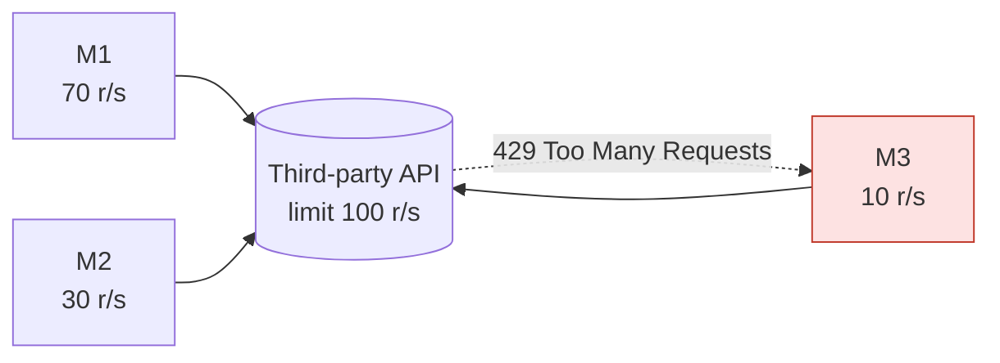

M1 and M2 together already use the full 100 r/s. M3 sends a modest 10 r/s and
is the one that gets rejected, even though it is the least demanding caller.
Retrying blindly makes it worse: every retry burns more of the shared budget.

Requirements that came out of this:

1. Track usage of the third-party limit across **all** services.
2. Give each service a **fair, guaranteed share** so all of them run smoothly.
3. When the budget is exhausted anyway, **queue requests in Redis** instead
   of failing them, and replay them when tokens are available again.
4. If the third party still returns 429, absorb it and recover.

## 2. Solution overview

A small gateway service, `ratelimiter`, sits between the services and the
third party. All shared state lives in Redis, so the gateway itself is
stateless and can run as several instances.

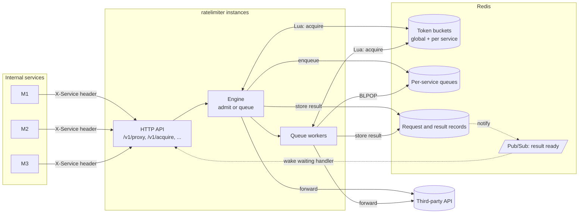

Two ways to use it:

| Mode | Who calls the third party | When to use |
|---|---|---|
| **Proxy** (`/v1/proxy/...`) | The limiter forwards the request | Default. Gives queueing, replay and 429 absorption for free. |
| **Acquire** (`/v1/acquire/...`) | The service, after being granted a token | When the request cannot be proxied (streaming, mutual TLS, SDK-generated calls), or when the caller is itself a gateway that wants to admit or refuse its own clients (au1h does this per application, see the au1h `examples/rate-limit-demo`). With `wait`, the limiter holds the call until a token is free, so the caller still gets fair queueing. The service reports any 429 it sees via `/cooldown`. |

## 3. Components

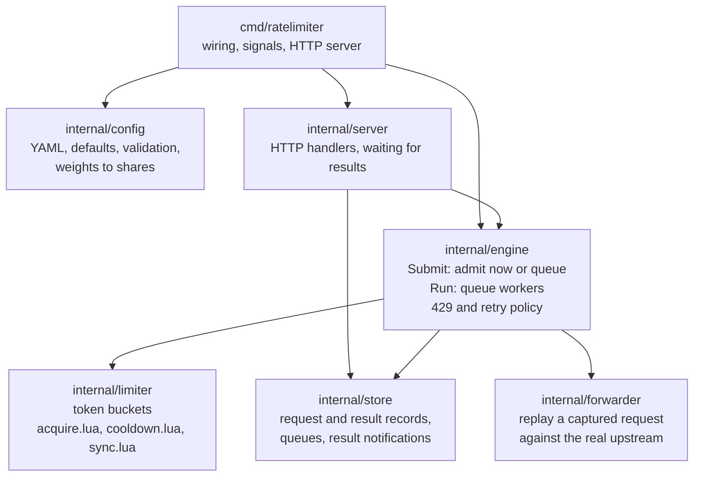

| Package | Responsibility | Key types |
|---|---|---|
| `internal/config` | Parse YAML, apply defaults, validate, convert service weights into per-service rate and burst | `Config`, `Upstream`, `LimiterSpec()` |
| `internal/limiter` | The shared token buckets. Every decision is one Lua script execution, so it is atomic across all limiter instances | `Limiter.Acquire`, `Cooldown`, `SyncRemaining`, `Snapshot` |
| `internal/store` | Persist captured requests and their results, per-service FIFO queues, and wake HTTP handlers when a result lands | `Request`, `Result`, `Store.Wait` |
| `internal/forwarder` | Rebuild the HTTP request from a stored record, send it, interpret 429 and quota headers | `Forwarder.Do`, `Outcome` |
| `internal/engine` | One engine per upstream. Decides fast path vs queue, runs workers, applies retry and cooldown policy | `Upstream.Submit`, `Run`, `process` |
| `internal/server` | Routes, header parsing, waiting with timeout, response mapping | `Server` |
| `examples/fake-upstream` | A third-party stand-in with a strict sliding window and `Retry-After` | |
| `examples/loadgen` | Simulates M1, M2, M3 at chosen rates and reports what each saw | |

## 4. Admission: the two-tier token bucket

### 4.1 Buckets

Each upstream has one **global bucket** that mirrors the third party's limit
and one **service bucket** per caller, sized by weight.

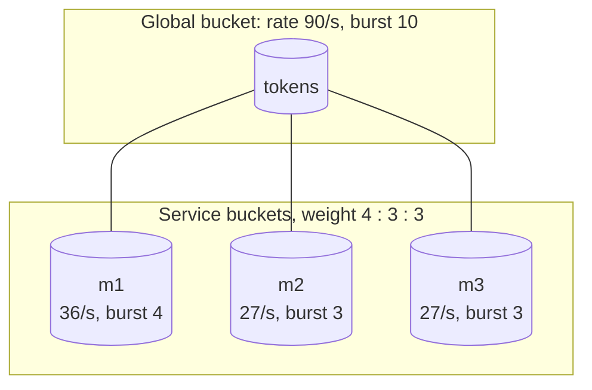

A service's share is `weight / sum(weights)` of both the global rate and the
global burst. The service rates add up to the global rate, so when every
service is busy each one gets exactly its share. A share with a burst below
one token is floored at 1 so the service can still be admitted on its own.

Buckets are lazily refilled: each bucket stores `tokens` and the timestamp
`ts` of the last update. On every access the script computes
`min(burst, tokens + (now - ts) * rate)`. `now` comes from Redis `TIME`, so
all limiter instances agree on the clock.

### 4.2 The decision

One request runs one execution of `acquire.lua`. Redis executes scripts
atomically, so two limiter instances can never both spend the same token.

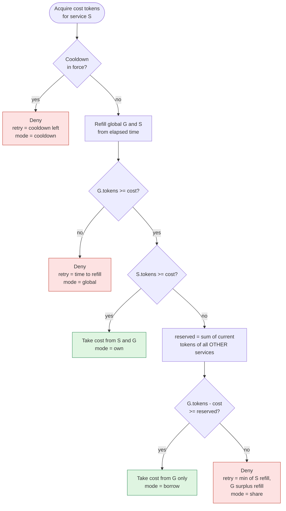

The borrowing rule is what makes the scheme both fair and efficient:

- A service that stays within its share is always admitted while the global
  bucket has tokens. Its reserve is never touched by others, because a
  borrower must leave at least `reserved` tokens behind.
- A service that exceeds its share gets everything the others are not using.
  If m2 and m3 are idle, m1 can consume the entire global rate.
- The sum of admitted requests can never exceed the global bucket, whatever
  the services do.

Worked example with the buckets above, all full (G = 10, m1 = 4, m2 = 3, m3 = 3):

| Step | Caller | G before | Decision | Why |
|---|---|---|---|---|
| 1 to 4 | m1 | 10 to 7 | own | m1 has 4 tokens of its own |
| 5 | m1 | 6 | **share** (deny) | borrowing would leave 5, but m2 + m3 reserve 6 |
| 6 to 8 | m2 | 6 to 4 | own | m2's guaranteed share is intact |
| 9 to 11 | m3 | 3 to 1 | own | m3's guaranteed share is intact |
| 12 | anyone | 0 | **global** (deny) | the third party's limit is the ceiling |

Half a second later m1 has refilled 2 tokens and G has refilled to 10 (capped).
m1 takes its 2, leaving G = 8, and may now borrow 2 more because 8 - 1 >= 6
still holds for the first and 7 - 1 >= 6 for the second. m2 and m3 still find
their full 3 tokens each when they wake up.

### 4.3 Other scripts

| Script | Trigger | Effect |
|---|---|---|
| `cooldown.lua` | Third party answered 429, or a service reported one | Stores `cd_until = now + retry_after` on the global bucket and sets its tokens to 0. A later, longer cooldown extends it; a shorter one never cuts it. |
| `sync.lua` | A response carried the configured remaining-quota header | Lowers the global bucket to `remaining` if it currently believes it has more. It never raises it. |

## 5. Request lifecycle

### 5.1 Proxy call, fast path and queued path

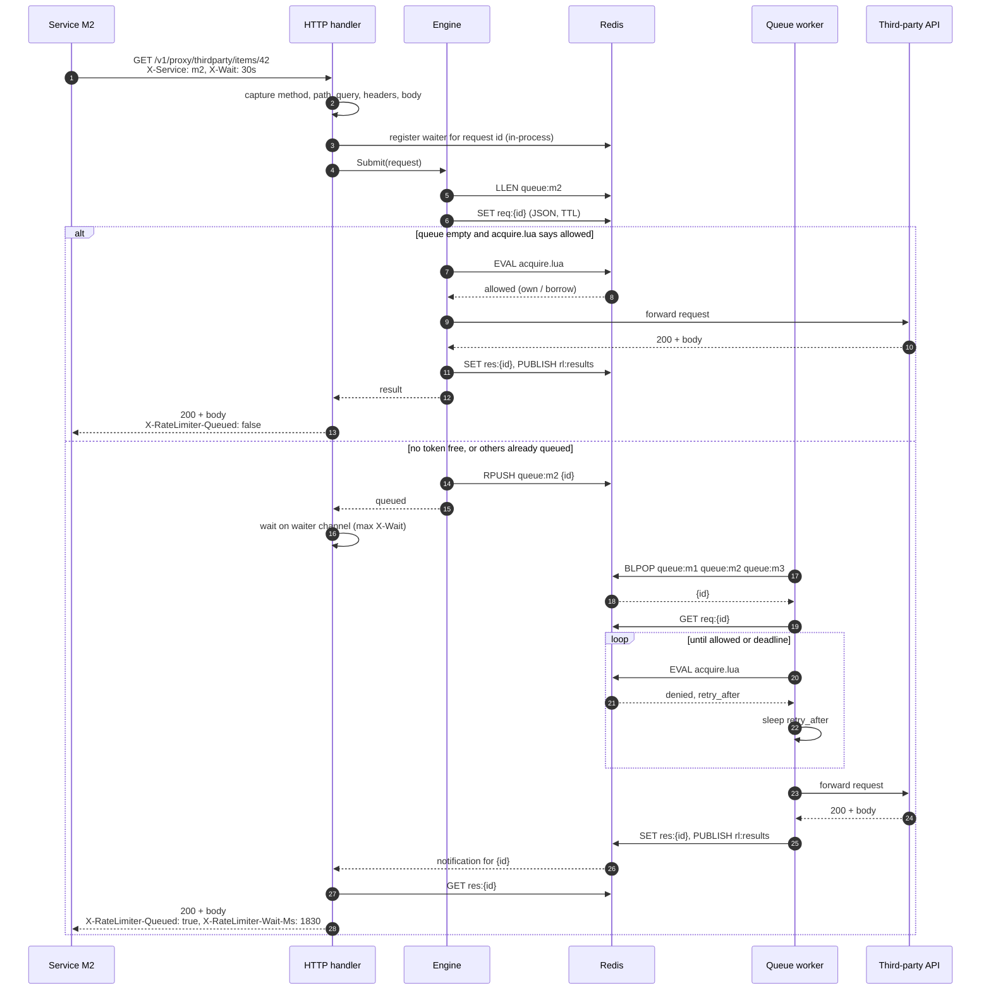

Notes on the handler side:

- The waiter is registered **before** `Submit`, so a result stored by a
  worker between enqueue and wait cannot be missed.
- If `X-Wait` elapses first, the handler answers `202 Accepted` with the id
  and a `Location` header. The request stays queued and is still processed;
  the service polls `GET /v1/requests/{id}` for the stored response.
- A one-second poll of the result key runs alongside the notification, so a
  lost Pub/Sub message costs at most a second of latency.

### 5.2 States of a request

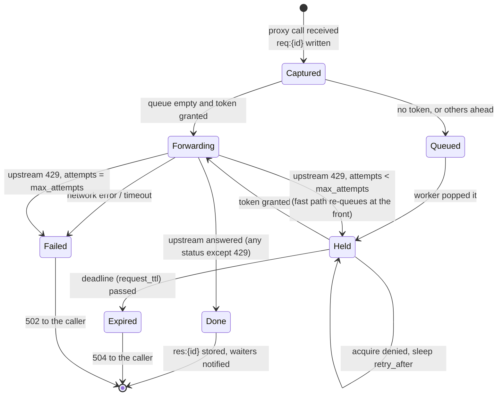

## 6. Queueing and workers

Each upstream has one Redis list per service holding request ids, so a burst
from m1 can never push m2's requests back. Request bodies are stored once in
`req:{id}` and the lists only carry ids.

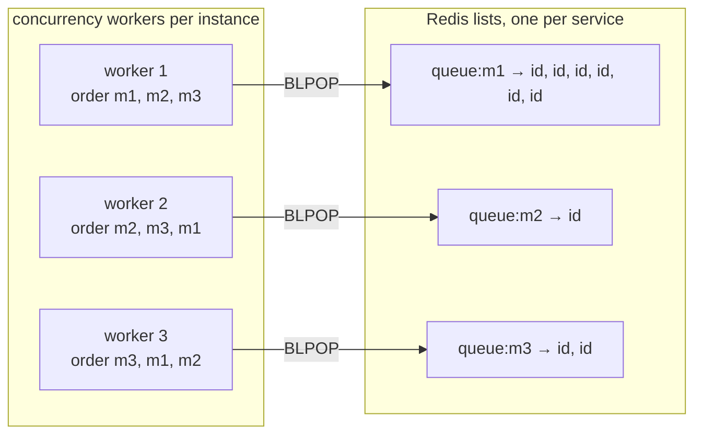

- Workers block on `BLPOP` across all service queues. Redis serves the first
  non-empty key in the order given, so each worker **rotates the key order on
  every pop**. A long m1 backlog does not stop m2's single request from being
  picked up promptly.
- A worker holds its request through the admission loop. Fairness between
  services is enforced by the buckets, not by the pop order: an m1 worker
  denied with `share` sleeps while an m2 worker is admitted on m2's reserve.
- `concurrency` bounds in-flight upstream calls per instance. It also bounds
  how many requests are held in memory rather than in Redis.

## 7. Handling a 429 from the third party

Our bookkeeping can drift from the third party's: it may count differently,
have other clients we do not know about, or change its limit. A 429 is the
signal to resynchronise.

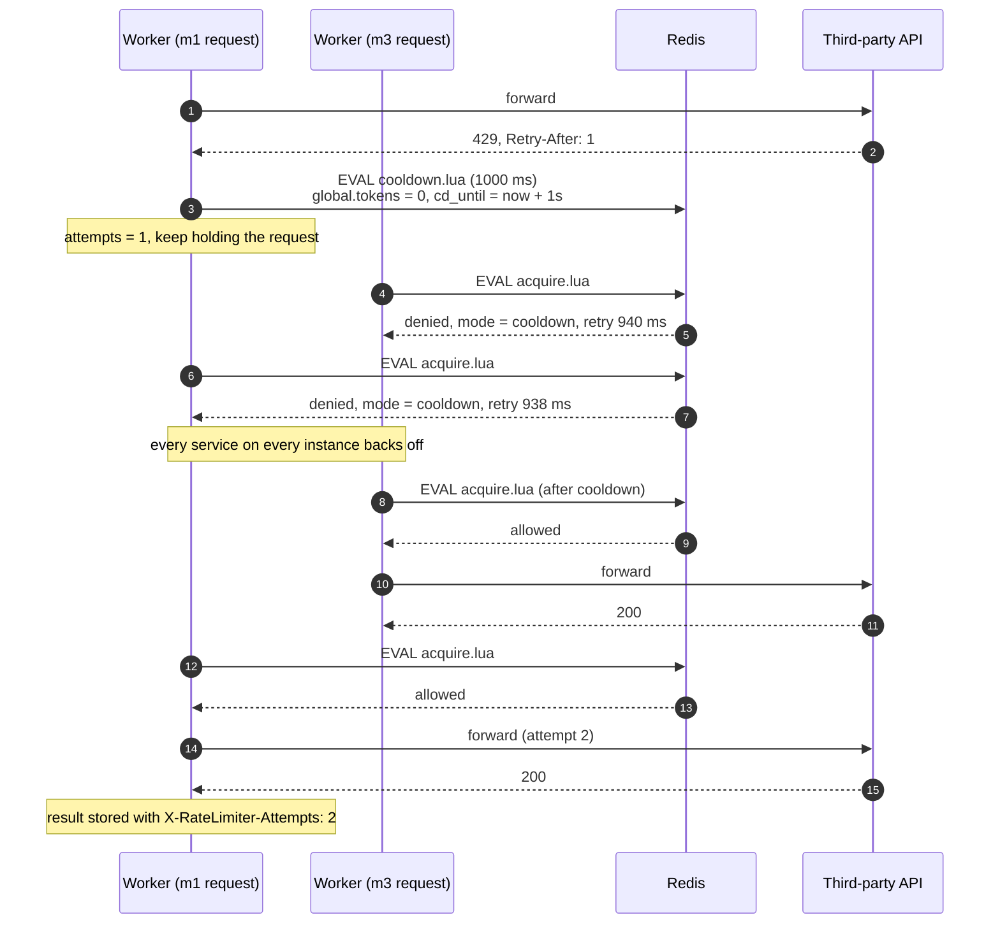

Policy details:

- `Retry-After` may be seconds or an HTTP date. Missing or unparsable values
  fall back to `default_cooldown`. Cooldowns are capped at five minutes.
- The cooldown is stored as an absolute timestamp on the global bucket, not as
  a key with a TTL, so it works identically on any Redis and in tests.
- A request is retried up to `max_attempts` times; after that the caller gets
  `502` with the attempt count. Any other upstream status, including 5xx, is
  returned to the caller as is, because the limiter cannot know whether the
  call is safe to repeat.
- On the fast path (handler forwarding inline), a 429 pushes the request to
  the **front** of its service queue so it does not lose its place.
- In acquire mode, a service that sees a 429 calls
  `POST /v1/upstreams/{upstream}/cooldown` so the other services back off too.

## 8. Redis data model

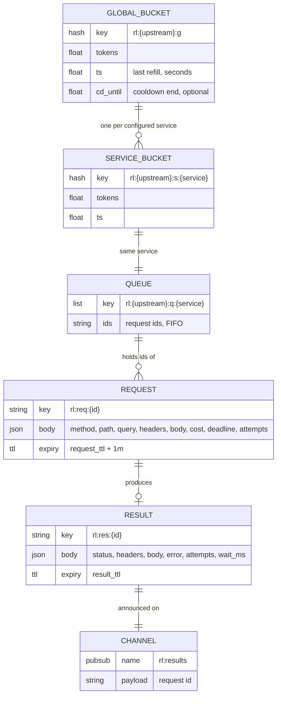

- Bucket keys carry a `{upstream}` hash tag, so in Redis Cluster all keys one
  `acquire.lua` call touches live in one slot.
- Bucket hashes expire after they would have refilled completely anyway, so
  an idle service leaves no state behind and reappears full.
- Request and result records are plain JSON strings; bodies are base64 inside
  the JSON and limited by `max_body_bytes`.

## 9. HTTP API

| Method and path | Purpose | Success | Errors |
|---|---|---|---|
| `ANY /v1/proxy/{upstream}/{path}` | Forward to `base_url + path` with the same method, query, headers and body | Upstream status and body, plus `X-RateLimiter-*` headers. `202` with `Location` if still queued after `X-Wait` | `400` bad header, `403` unknown service, `413` body too large, `503` + `Retry-After` queue full, `502` upstream failed or kept rejecting, `504` expired in queue |
| `GET /v1/requests/{id}` | Fetch the stored response of a queued request | Upstream status and body, or `202` while queued | `404` unknown or expired id |
| `POST /v1/acquire/{upstream}` | Take tokens for a service that calls the upstream itself. Body `{"service":"m1","cost":1,"wait":"5s"}`. With `wait`, the call is held until a token is free or the wait elapses: the caller gets the queue without proxying its request through the limiter | `200 {"allowed":true,"mode":"own","waited_ms":0}` | `429` with `Retry-After` and `retry_after_ms`, `403` unknown service |
| `POST /v1/upstreams/{upstream}/reset` | Refill every bucket (demos, tests) | `200` | |
| `POST /v1/upstreams/{upstream}/cooldown` | Report a 429 seen directly. Body `{"retry_after_ms":1000}` | `200` | |
| `GET /v1/upstreams/{upstream}/stats` | Bucket levels, cooldown remaining, queue depth and blocking acquires waiting per service | JSON | |
| `GET /v1/upstreams` | List configured upstreams | JSON | |
| `GET /healthz` | Liveness | `200` | |

Request headers understood by the proxy endpoint:

| Header | Meaning | Default |
|---|---|---|
| `X-Service` | Which configured service is calling. Required. | |
| `X-Cost` | Tokens this call consumes, for endpoints the third party weights differently | `1` |
| `X-Wait` | How long to hold the connection for a queued answer. `0s` means fire-and-poll. | `default_wait` |
| `X-Callback-Url` | URL to `POST` the result JSON to when done | none |

Response headers added by the limiter:

| Header | Meaning |
|---|---|
| `X-RateLimiter-Request-Id` | Id to use with `/v1/requests/{id}` |
| `X-RateLimiter-Queued` | `true` if the request waited in the queue |
| `X-RateLimiter-Wait-Ms` | Milliseconds between arrival and completion |
| `X-RateLimiter-Attempts` | Upstream attempts; more than 1 means a 429 was absorbed |

## 10. Configuration and sizing

See `config.example.yaml` for every field. The two numbers that matter most:

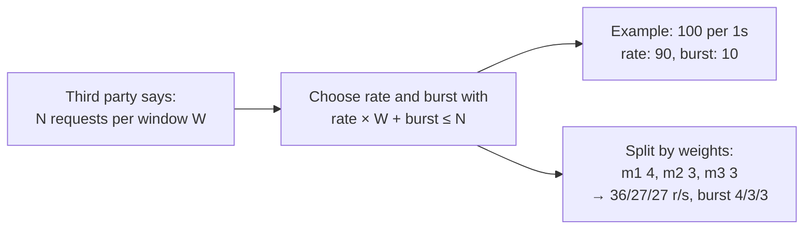

A token bucket admits at most `burst + rate × T` requests in any `T` seconds.
Setting `rate: 100, burst: 100` against a "100 per second" window would allow
200 in the first second and trip the third party immediately. The example
configuration uses `rate: 90, burst: 10`, which is why the demo peaks at 98
requests in any one-second window and never sees a 429.

Other settings and their effect:

| Setting | Effect |
|---|---|
| `services.<name>.weight` | Share of rate and burst. Unused share is lent to others. |
| `max_queue_depth` | Per-service backlog before callers get `503`. Protects Redis memory. |
| `request_ttl` | Maximum time a request may wait before it is expired with `504`. |
| `result_ttl` | How long a finished response stays pollable. |
| `concurrency` | Workers, and therefore in-flight upstream calls, per limiter instance. |
| `max_attempts` | Upstream 429s tolerated per request. |
| `default_cooldown` | Backoff when a 429 has no usable `Retry-After`. |
| `remaining_header` | Upstream header to sync the global bucket from, for example `X-RateLimit-Remaining`. |
| `default_wait` | How long proxy calls block for a queued answer before `202`. |

## 11. Scaling and failure modes

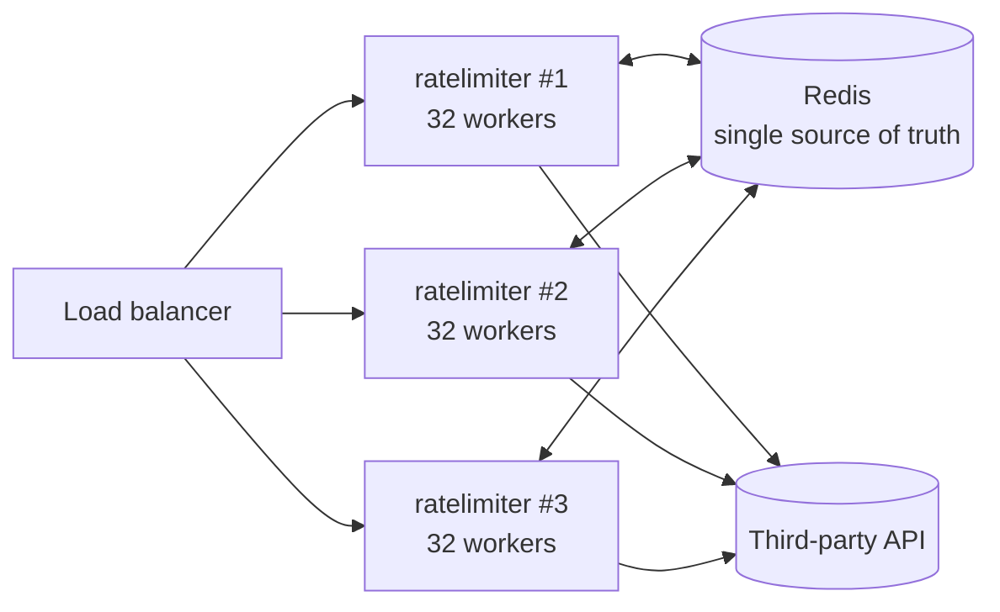

- **Horizontal scaling**: all decisions and all state are in Redis, so any
  instance can accept any request and any worker can drain any queue. The
  shared bucket caps the total regardless of instance count.
- **Clock**: scripts use Redis `TIME`, so instances need no clock agreement
  among themselves.
- **Redis unavailable**: acquire fails, the handler queues the request, and
  the enqueue fails too; the caller gets `500`. Workers retry Redis
  operations with a short backoff and resume when it returns. The limiter
  deliberately does not "fail open", since that is exactly how the third
  party's limit gets tripped.
- **Instance crash**: a request that a worker had already popped is lost. The
  caller's `X-Wait` expires with a `202`, and polling returns `404` after
  `request_ttl`. Everything still in the lists is picked up by surviving
  instances. A processing list with reclaim is the natural next step.
- **Caller disconnects** while waiting: the request stays queued and is still
  sent and its result stored. If the call was not idempotent, the caller can
  find the outcome under `/v1/requests/{id}`.
- **Third party changes its limit**: the first 429 triggers a cooldown, and
  `remaining_header` (if the third party provides one) keeps the bucket in
  step from then on. Adjust `rate` in the config for a permanent change.

## 12. SDKs

The admission logic lives in the Lua scripts, so a package can run it against
Redis without the service in the request path. `sdk/` holds Go, TypeScript,
Python, Rust, Ruby, PHP, Java and Kotlin packages with one middleware each,
all reading the shares the service publishes to `rl:{upstream}:config` and all
tested against `sdk/conformance/cases.json`. Proxy mode (queue and replay)
stays in the service. Details in [`sdk/README.md`](../sdk/README.md).

## 13. Verification

Unit tests run against an in-memory Redis (miniredis) with a controlled clock
and cover the admission invariants directly:

| Test | Checks |
|---|---|
| `TestBurstIsSplitByShare` | From a full pool m1 gets exactly its 40 of 100, m2 and m3 still get 30 each, then everyone is refused on the global limit |
| `TestBorrowingUsesIdleCapacityWithoutStarvingOthers` | After a refill m1 borrows the global surplus, and m2 and m3 still find their full reserves |
| `TestSingleServiceCanReachFullRateWhenOthersIdle` | Over one second alone, m1 gets ~100 r/s, not just its 40 r/s share |
| `TestGlobalCeilingHoldsUnderContention` | Three greedy services over two seconds admit at most `burst + 2 × rate` |
| `TestCooldownBlocksEveryone` | A cooldown refuses every service and drains the pool |
| `TestSyncRemainingOnlyLowers` | Quota sync lowers but never raises the bucket |
| `TestProxyForwardsAndQueuesWithoutUpstream429` | 60 concurrent calls from three services all return 200, most via the queue, with zero upstream 429s |
| `TestUpstream429TriggersCooldownAndRetry` | An upstream stricter than configured produces 429s that are absorbed and retried; callers only see 200 |
| `TestAsyncSubmitAndPoll` | `X-Wait: 0s` returns 202 and the response is later available by id |
| `TestValidationAndAcquireAPI` | Error mapping, acquire mode, cooldown endpoint, stats |

End-to-end run on a real Redis with the fake upstream limited to 100 per
second and services demanding 140 r/s in total:

```
service  sent  200  429  other  queued  retried  p50     p95     max
m1       699   699  0    0      691     0        5.549s  6.722s  8.096s
m2       300   300  0    0      281     0        322ms   1.992s  3.92s
m3       400   400  0    0      393     0        1.836s  2.929s  4.216s

1399 requests, 1399 ok, 0 rate limited as seen by services
third-party API saw: accepted=1399 rejected_429=0 peak_in_window=98 (limit 100 per 1s)
```

And with the upstream secretly limited to 60 per second while the limiter was
configured for 90:

```
480 requests, 480 ok, 0 rate limited as seen by services
third-party API saw: accepted=480 rejected_429=7 peak_in_window=60 (limit 60 per 1s)
```

The seven upstream rejections were absorbed by cooldown and retry; every
service request still completed with 200.
